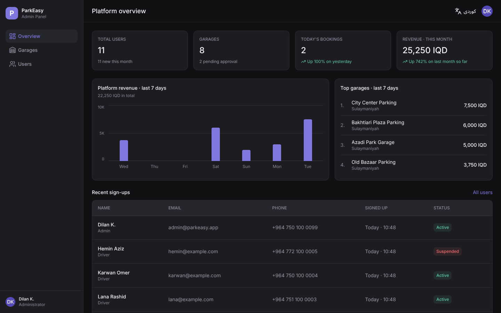
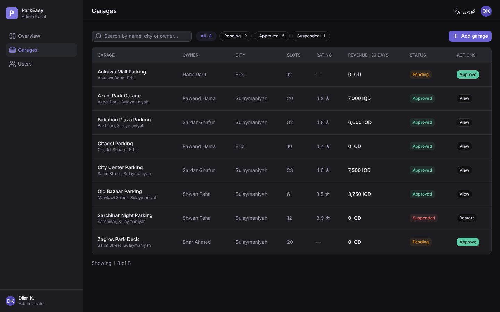
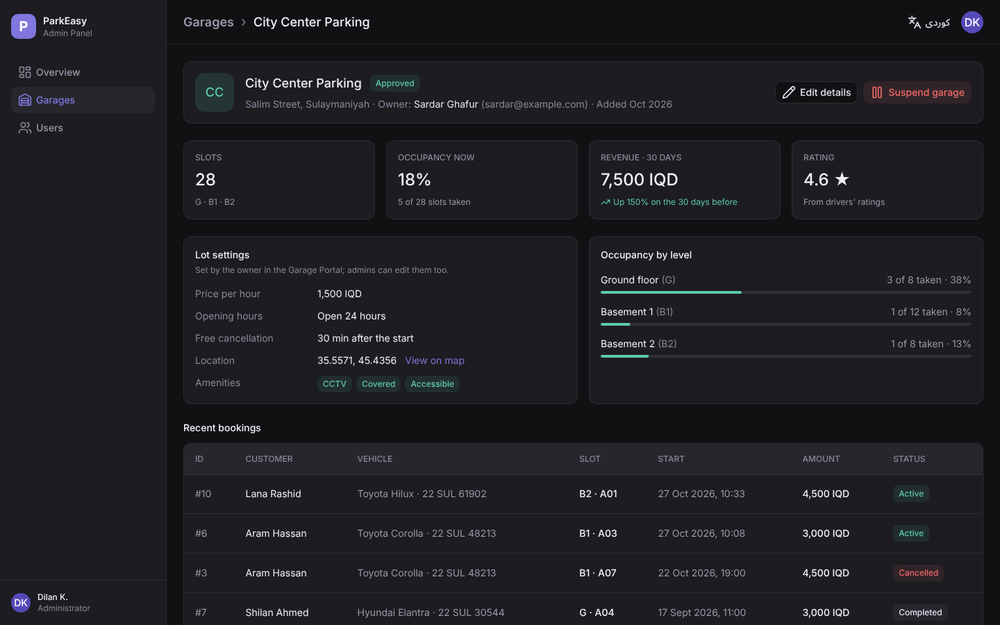
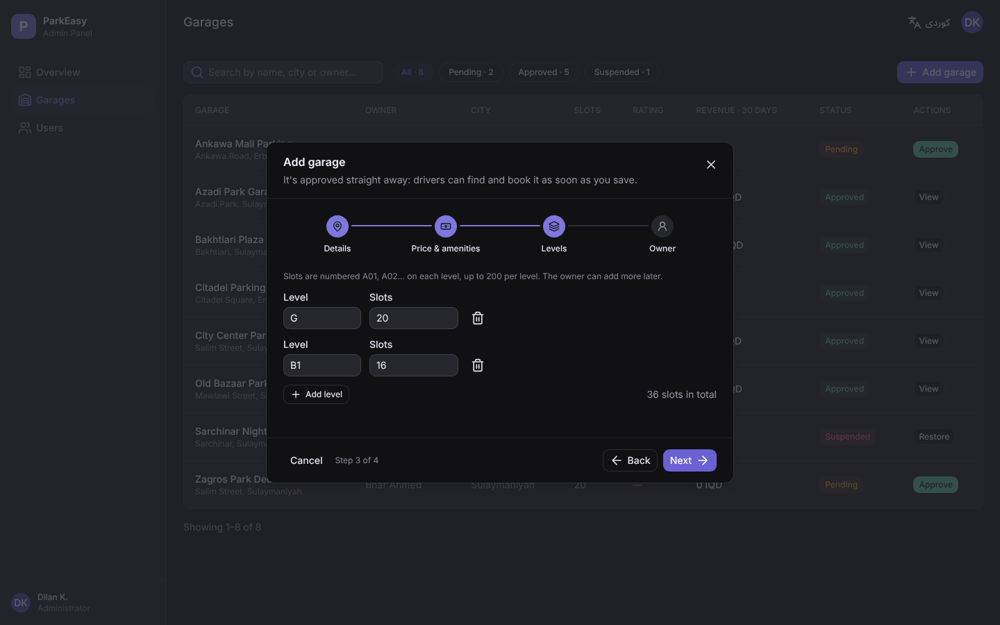
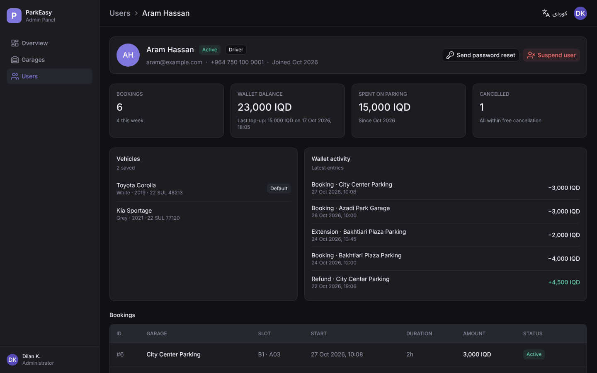
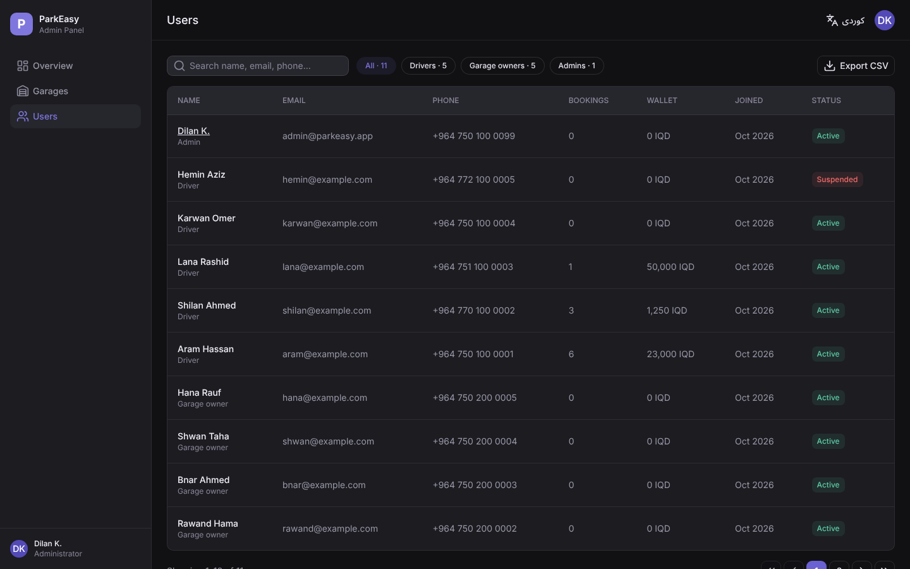
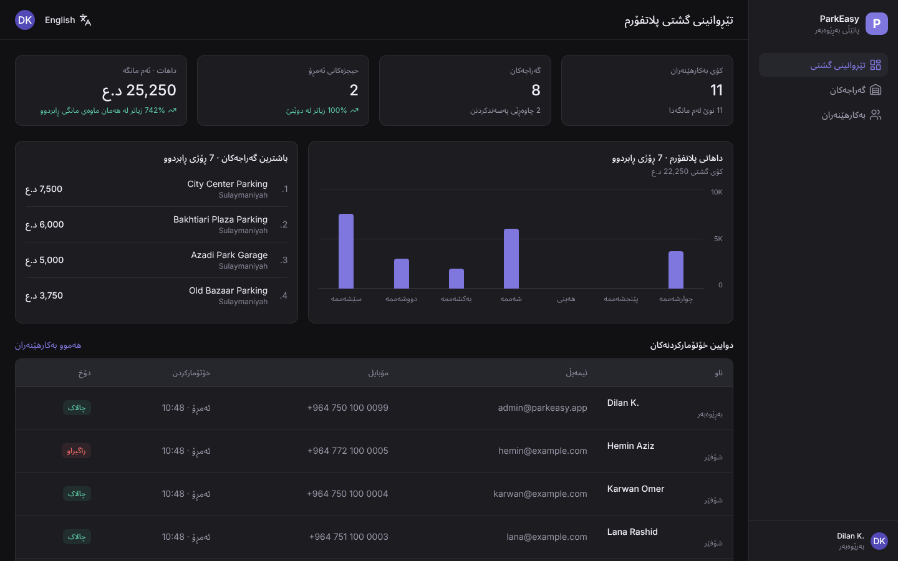
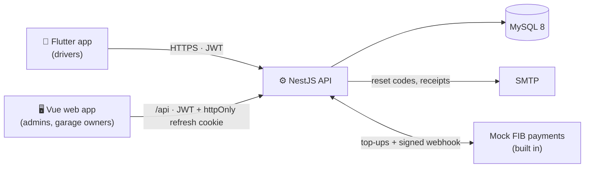

# 🅿️ ParkEasy

**A full-stack parking platform for Iraqi cities.** Drivers find a garage near them, book a slot, extend or end their stay and pay from an in-app wallet. Admins approve garages, manage accounts and watch the numbers. Garage owners get their own portal: a live dashboard, every slot at a glance, and walk-in cars charged at the exit (more pages in progress).

[](https://github.com/diladev/parkeasy/actions/workflows/backend.yml)
[](https://github.com/diladev/parkeasy/actions/workflows/web.yml)
[](https://github.com/diladev/parkeasy/actions/workflows/mobile.yml)


-1d9e75)



## What's inside

| App | Stack | For |
|---|---|---|
| 📱 [`mobile/`](./mobile) | Flutter · Clean Architecture · BLoC · dartz · get_it · flutter_map | Drivers: find nearby garages on a map, scan a lot's QR sign, book, extend, end early, wallet top-ups, notifications, PDF receipts |
| ⚙️ [`backend/`](./backend) | NestJS 11 · Sequelize · MySQL 8 · Passport JWT · nestjs-i18n · Swagger | One REST API for all apps, with errors and emails translated per request (English / Kurdish) |
| 🖥️ [`web/`](./web) | Vue 3.5 · Vite · TypeScript · Nuxt UI · Pinia · TanStack Query · Zod · vue-i18n | Admin Panel (done) and Garage Portal (sign-in, password reset, dashboard, live slots and walk-ins so far), one app with English and right-to-left Kurdish |

Everything was designed in Figma first (35 mobile screens and 10 dashboard screens) with one shared dark design system.

## Screenshots

| | |
|---|---|
|  |  |
| **Garages:** search, filter by status, approve in one click | **Garage page:** live occupancy per level, 30-day revenue, recent bookings |
|  |  |
| **Add garage:** a 4-step form that checks each step before moving on | **User page:** bookings, wallet, vehicles; suspend or send a password reset |
|  |  |
| **Users:** search by name, email or phone (spaces ignored), CSV export | **Kurdish (Sorani):** the whole UI mirrors right to left |

## How it fits together



- **One API, three clients.** Roles (`driver`, `garage_owner`, `admin`) decide what each account may do; the permission guard re-reads the role from the database on every admin request, so a demotion or suspension takes effect immediately.
- **Payments:** Stripe isn't available in Iraq, so wallet top-ups go through a built-in stand-in for FIB (First Iraqi Bank) with the same flow as a real provider: a pending payment, approval on another screen, and a signed webhook.

## Engineering highlights

**Security**
- Access tokens live in memory (web) and expire after 15 minutes. Refresh tokens rotate on every use and are stored only as a hash, so each one works once and a leaked database can't be used to sign in.
- Passwords are peppered with HMAC-SHA256 before bcrypt, so long passwords keep the pepper inside bcrypt's 72-byte limit.
- CSRF protection uses `Sec-Fetch-Site` checks, the sign-in and password-reset endpoints are rate-limited, and every request body is whitelisted and validated.
- The web app is built to run under a strict Content Security Policy: no inline scripts or styles, icons bundled, no third-party requests.
- Admin CSV exports neutralise spreadsheet formulas (CSV injection).

**Correctness**
- Multi-step writes run in transactions: a booking with its payment, or a garage with its levels, slots and owner account.
- Status changes use conditional updates, so two admins acting at once can't both "win" with stale data.
- Times are handled in Iraq time (UTC+3), not the server's clock.

**Kurdish and accessibility**
- Kurdish (Sorani) is supported end to end: the API translates errors and emails from the `x-lang` header, and the web and mobile apps switch to right-to-left.
- Names, phone numbers and amounts stay readable inside RTL text (Unicode isolates); Kurdish month and weekday names are built in, because browsers don't ship them.
- The web app is keyboard-friendly: focus moves to the first field to fix, dialogs trap focus, and the chart has a table for screen readers. Text colours were adjusted to meet WCAG AA contrast.

**Testing and CI** (GitHub Actions, on every push and pull request)

| App | What runs |
|---|---|
| Backend | ESLint + Prettier, build, 121 unit tests (Jest), then API tests against a real MySQL 8 seeded with the demo data |
| Web | oxlint + ESLint (0 warnings), Prettier, `vue-tsc`, 229 component and unit tests (Vitest + MSW), production build |
| Mobile | `flutter analyze`, `flutter test` |

Dependabot keeps dependencies current, and pull requests are checked for newly added vulnerable packages.

## Getting started

**You need:** Node.js 24 LTS (see [`.nvmrc`](./.nvmrc)), Docker, and the Flutter SDK (stable) for the mobile app.

**1. Settings and database**
```bash
git clone https://github.com/diladev/parkeasy.git
cd parkeasy
cp .env.example .env             # then fill in the JWT secrets and PEPPER_SECRET
# a secret:  node -e "console.log(require('crypto').randomBytes(48).toString('base64url'))"
docker compose up -d db          # MySQL 8 on localhost:3306, using DB_NAME and DB_PASSWORD from .env
```

**2. API** (http://localhost:3001, docs at http://localhost:3001/docs)
```bash
cd backend
npm ci
npm run seed                     # demo garages, drivers, bookings and wallets
npm run start:dev
```

**3. Web app** (Admin Panel at http://localhost:5173/admin, Garage Portal at http://localhost:5173/garage)
```bash
cd web
npm ci
npm run dev                      # /api is proxied to the API on port 3001
```

**4. Mobile app**
```bash
cd mobile
flutter pub get
flutter run --dart-define=API_BASE_URL=http://10.0.2.2:3001   # Android emulator
# iOS Simulator: http://127.0.0.1:3001 · real phone: your computer's LAN IP
```
Printable QR signs for the demo garages are in [`docs/demo-qr`](./docs/demo-qr).

### Demo accounts

Every demo account's password is `Demo@1234`.

| Account | Email | Shows |
|---|---|---|
| Admin | `admin@parkeasy.app` | The Admin Panel |
| Driver | `aram@example.com` | An active booking, full history, wallet in use |
| Driver | `lana@example.com` | Two vehicles, unread notifications |
| Driver | `karwan@example.com` | A brand-new account (empty screens) |
| Driver | `hemin@example.com` | A suspended account (sign-in refused) |
| Garage owner | `sardar@example.com` | The Garage Portal: owns City Center and Bakhtiari Plaza, with cars parked without the app |
| Garage owner | `hana@example.com` | The Garage Portal with a garage still waiting for approval |

## Project structure

```
parkeasy/
├── backend/            NestJS API: one module per area (auth, parking, booking, wallet,
│                       payments, notifications, admin-*), Jest tests, e2e tests in test/
├── web/                Vue app: src/app (shell, router, i18n), src/features/<area>
│                       (pages, components, API calls), src/shared (UI kit, helpers)
├── mobile/             Flutter app: lib/core + lib/feature/<area>/{data,domain,presentation}
├── docs/               Screenshots and demo QR signs
├── .github/            CI workflows and Dependabot
└── docker-compose.yml  MySQL for local development
```

## Running the checks locally

```bash
cd backend && npm run lint:check && npm run format:check && npm test && npm run test:e2e   # e2e needs the seeded database
cd web     && npm run lint && npm run format:check && npm run type-check && npm test
cd mobile  && flutter analyze && flutter test
```

## Roadmap

- **Garage Portal:** bookings, reports and lot settings with an hourly rate, a daily cap and holiday prices (sign-in, password reset, the dashboard, live slots and walk-ins are done).
- **Admin Panel:** transactions, reports and settings pages; global search and notifications.
- **Mobile:** live GPS location and a payment-methods screen.
- **Deployment:** Docker images for the API and web app (nginx with security headers) and a public demo.
